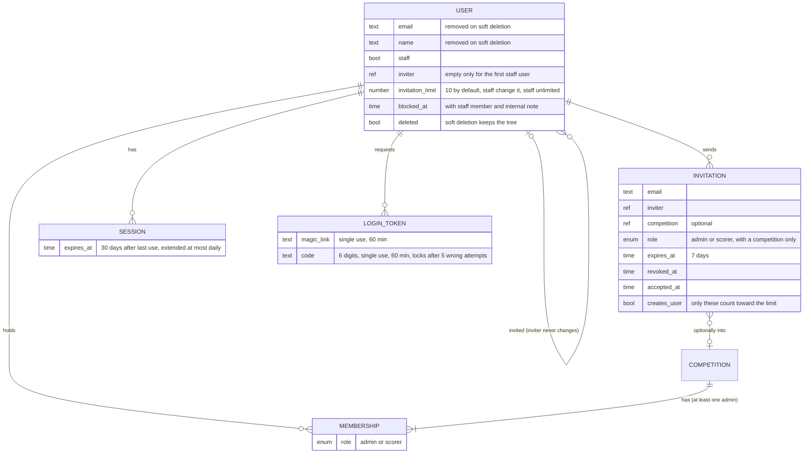
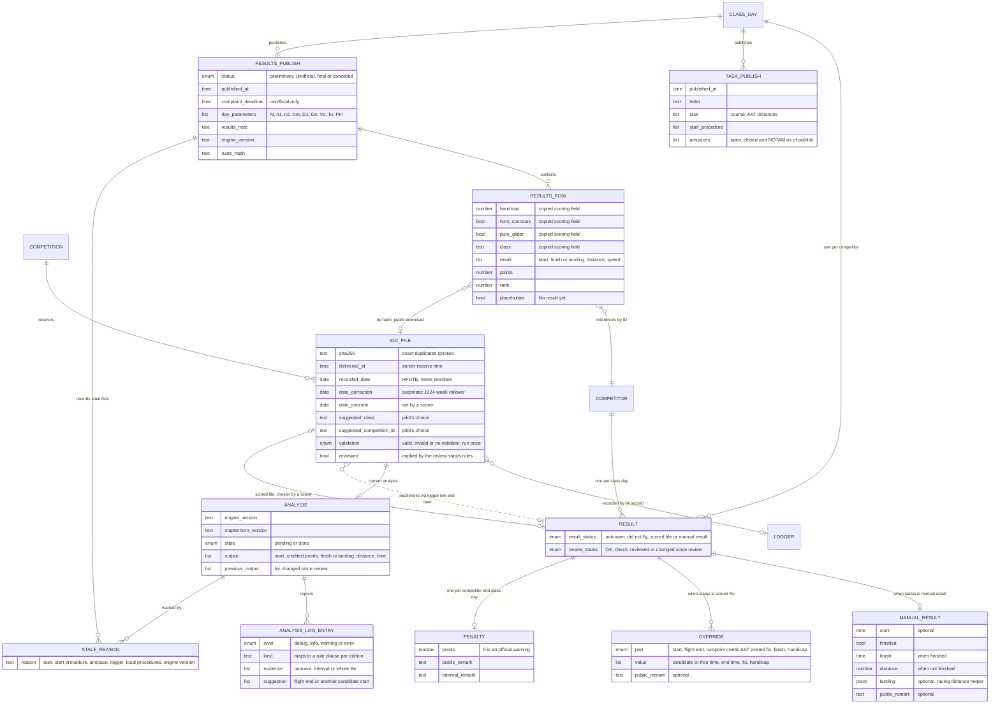

# PROTOTYPE: Keyhole domain model

Throwaway draft for [What entities, fields and relationships make up Keyhole's domain model?](https://github.com/Turbo87/keyhole/issues/120). It is drawn from the closed decisions of [Wayfinder: Keyhole MVP](https://github.com/Turbo87/keyhole/issues/1) and `GLOSSARY.md`. Fields are domain fields, not columns. Types are loose labels: `text`, `number`, `date` (local calendar date), `time` (instant), `enum`, `point`, `ref` and `list`.

The model is split into three diagrams that share entity names. Each entity's lifetime is in [Lifetimes](#lifetimes), and everything that didn't fit cleanly is in [Contradictions and gaps](#contradictions-and-gaps).

## Platform and membership



## Competition setup

```mermaid
erDiagram
    RULE_SET_EDITION ||--o{ COMPETITION : "scores under"
    RULE_SET_EDITION ||--|{ CLASS_TEMPLATE : defines
    CLASS_TEMPLATE }o--o| HANDICAP_LIST : prefills
    HANDICAP_LIST ||--|{ HANDICAP_LIST_ENTRY : contains

    COMPETITION ||--o| AIRSPACE_FILE : "has one"
    AIRSPACE_FILE ||--|{ AIRSPACE : contains
    COMPETITION ||--o| TURNPOINT_FILE : "has one"
    TURNPOINT_FILE ||--|{ TURNPOINT : contains
    COMPETITION ||--|| LOCAL_PROCEDURES : "competition layer"

    COMPETITION ||--o{ CLASS : has
    CLASS }o--o| CLASS_TEMPLATE : "prefilled from once"
    CLASS }o--o| HANDICAP_LIST : uses
    CLASS ||--|| LOCAL_PROCEDURES : "class layer"
    CLASS ||--o{ CLASS_DAY : "has (created lazily)"
    CLASS_DAY ||--|| LOCAL_PROCEDURES : "class day layer"

    CLASS_DAY ||--o{ TASK_CANDIDATE : prepares
    CLASS_DAY |o--o| TASK_CANDIDATE : "published task"
    TASK_CANDIDATE ||--|{ TASK_POINT : "ordered, replaced whole"
    TASK_POINT }o--|| TURNPOINT : "linked by name, coordinates copied"
    CLASS_DAY ||--o{ AIRSPACE_EXCEPTION : has
    AIRSPACE_EXCEPTION }o--|| AIRSPACE : "opens or closes"
    CLASS_DAY ||--o{ NOTAM_AIRSPACE : "always closed"

    CLASS ||--o{ COMPETITOR : enters
    COMPETITOR ||--|{ CREW_MEMBER : "ordered crew"
    COMPETITOR }o--o| HANDICAP_LIST_ENTRY : "remembers prefill"
    COMPETITION ||--o{ LOGGER : "unique per competition"
    LOGGER ||--|{ LOGGER_LINK : "dated timeline"
    LOGGER_LINK }o--o| COMPETITOR : "linked to, or not linked"

    RULE_SET_EDITION {
        text id "DAeC SWO 2026 or FAI Annex A 2025a, immutable"
        list allowed_earth_models
        list parameter_defaults "Dm, D1, zones, delivery period, margins, complaint period"
    }
    CLASS_TEMPLATE {
        text name "Club, Standard, 18 m"
        number dm
        number d1
        bool handicapped
    }
    HANDICAP_LIST {
        text id "daec-2026, immutable edition"
        enum scale "1.000 or 100"
    }
    HANDICAP_LIST_ENTRY {
        text glider_type
        number handicap
    }
    COMPETITION {
        text name
        text slug "fixed at creation, unique including tombstones"
        text organiser "club or person"
        text location
        text country
        text time_zone "IANA"
        date first_date
        date last_date
        text website "optional"
        point airfield "optional at creation, needed for analysis"
        number airfield_elevation "m MSL"
        text standing_notes
        list flight_levels "printed in m MSL for the day's QNH"
        enum lifecycle "live, archived (tombstone) or deleted"
        time blocked_at "with staff member and internal note"
    }
    LOCAL_PROCEDURES {
        enum earth_model "competition, class, class day"
        bool finish_to_cylinder_edge "competition, class, class day"
        number delivery_period "minutes after landing"
        list default_zones "per role, competition only"
        number dm "class and class day only"
        number d1 "class and class day only"
        list start_procedure "opening, closing, max start altitude and ground speed, PEV"
        number tow_altitude "m MSL"
        number maximum_altitude "m MSL"
        time scoring_end
    }
    AIRSPACE_FILE {
        text openair "as uploaded, offered for download"
        time locked_at "first flight upload of the competition"
    }
    AIRSPACE {
        text name
        text category "AC and AY"
        bool opened "competition default, closed unless opened"
    }
    TURNPOINT_FILE {
        text cup "as uploaded, offered for download"
    }
    TURNPOINT {
        text name
        point position
        number elevation
    }
    CLASS {
        text name
        text colour "optional sRGB hex"
        ref template "display only"
        number dm
        number d1
        bool handicapped
        enum scale "1.000 or 100"
    }
    CLASS_DAY {
        date date "fixed"
        bool practice
        text daily_password "generated at creation"
        number qnh "hPa, task sheet only"
        text results_note "working value, copied into each results publish"
        bool cancelled
    }
    TASK_CANDIDATE {
        text letter "A, B, C, reorderable"
        enum task_type "racing or AAT"
        number minimum_task_time "AAT only"
        text day_notes
    }
    TASK_POINT {
        point position "copied from the turnpoint"
        number elevation "copied from the turnpoint"
        list zone "line length, or R1 A1 R2 A2 and orientation"
        number minimum_finish_height "finish only, m MSL"
    }
    AIRSPACE_EXCEPTION {
        enum direction "open or close"
    }
    NOTAM_AIRSPACE {
        text openair
    }
    COMPETITOR {
        text competition_id "unique per class, up to 5 characters"
        text glider_type
        text registration "optional"
        text display_name "optional, otherwise crew joined with &"
        number handicap "0 means not set in handicapped classes"
        bool pure_glider
        bool hors_concours
    }
    CREW_MEMBER {
        number position
        text first_name
        text last_name
        text club
        text country "ISO code"
    }
    LOGGER {
        text manufacturer "from the A record"
        text serial "from the A record"
        number enl_threshold "500"
        number mop_threshold "500"
        number cur_threshold "20 A"
        number minimum_duration "30 s"
    }
    LOGGER_LINK {
        date from_date "empty means from the start"
        ref competitor "empty means not linked"
        enum role "primary or secondary, at most one primary per competitor and date"
    }
```

## Flights, results and publishing



Derived and never stored: the day number, placeholder results, working day scores, overall results, the AAT nominal, minimum and maximum distances and the public CUP download. The public JSON files (directory, `competition.json`, `task.json`, `results.json` and `overall.json`) are renderings of the entities above.

## Lifetimes

| Lifetime | Entities and fields |
|---|---|
| Current state, live on public pages after every save | Competition master data, class, competitor display fields and current handicap, crew, logger IDs, the class day schedule |
| Current state, private working inputs | Local procedures, task candidates, airspace exceptions, NOTAM airspaces, daily password, QNH, results note, result, manual result, override, penalty, analysis |
| Dated history | Logger link, which is the only entity with dates of validity |
| Versioned and immutable, shipped by deploy | Rule set edition, class template, handicap list, `ENGINE_VERSION` |
| Snapshotted at publish | Task publish, results publish and its rows. A results row copies only scoring fields and references the competitor by ID for everything else |
| Fixed after an event | Slug after creation, airspace file after the first flight upload, task point coordinates after copying, the user's inviter |
| Write-only history | The audit log, which every decision names as the only place changes are kept but none defines |

## Contradictions and gaps

Each item is a candidate for its own ticket. None is settled here.

1. **Which date resolves a file to a logger link and class day.** [Is the primary logger's file scored ahead of a secondary that arrives first?](https://github.com/Turbo87/keyhole/issues/105) takes "its date from the IGC file", which is the UTC `HFDTE` date, while [Which analysis log entries does flight analysis report, and how are they reviewed?](https://github.com/Turbo87/keyhole/issues/26) and [How does Keyhole assign an IGC file whose recorded date doesn't match the class day?](https://github.com/Turbo87/keyhole/issues/57) use the local take-off date. They differ for flights that cross UTC midnight, such as Australian mornings.
2. **Which IGC files are public, and what archiving deletes.** [How long does Keyhole keep results and IGC files, and are IGC downloads public?](https://github.com/Turbo87/keyhole/issues/50) makes scored files public, lets a scorer keep a file private by unlinking it and has archiving delete unlinked files. Files can no longer be unlinked since [Is the primary logger's file scored ahead of a secondary that arrives first?](https://github.com/Turbo87/keyhole/issues/105). A file that was scored in a published snapshot and later replaced is still referenced by that snapshot's hash.
3. **Scorer uploads without a readable logger ID.** Scorer uploads keep lenient parsing per [How does a pilot upload a flight, and how is the competitor chosen?](https://github.com/Turbo87/keyhole/issues/95), but a file only reaches a result through a logger link. A file without a usable `A` record, or a manual-entry pilot's file from an unidentified device, has no path to a result now that assignment is gone.
4. **Overrides when the scored file changes.** Overrides sit on the result, but a start override can pick a candidate crossing and an AAT override pins a fix, both of which belong to one file. Nothing says whether overrides survive a switch of the scored file or a link edit that moves the scored file away.
5. **Analysis of a file that moves to another result.** A link edit, a role change or a date override can move a file to another competitor or class day. [Which input changes re-analyse flights automatically, and which only mark them stale?](https://github.com/Turbo87/keyhole/issues/75) lists only uploads, overrides and scored file switches as automatic, and a role change marks stale. Whether a moved file is analysed automatically against its new task or only marked stale is open.
6. **Where the review state lives.** The review status sits on the result per [Should a competitor's class day carry one state of unknown, did not fly, scored file or manual result?](https://github.com/Turbo87/keyhole/issues/102), but "a file no scorer has reviewed" and "the file shows up unreviewed on its new result" imply a per-file reviewed flag. Whether it exists, and whether it resets when a file moves, isn't stated.
7. **Which published snapshots are kept.** Overall results read only the latest results publish, but reverting a cancellation restores the previous status, and reopening republishes the existing snapshot. Whether earlier publishes are kept as history or only the latest and the pre-cancellation one is open, and so is whether task publishes are kept.
8. **Where the day status lives.** [Which day and flight statuses does Keyhole have, and what do they lock and publish?](https://github.com/Turbo87/keyhole/issues/13) stores the status with the snapshot and gives working results none, while the glossary and the public schedule treat it as a class day field that also covers unplanned and task published. Whether the status is a stored class day field or derived from the latest task and results publishes affects locking and the schedule in `competition.json`.
9. **Logger IDs in the public competition file under dated links.** [How does a pilot upload a flight, and how is the competitor chosen?](https://github.com/Turbo87/keyhole/issues/95) lists each competitor's logger IDs for upload prefill. With dated links, a logger can point to different competitors on different dates, and the file doesn't say which link entries it publishes or how the upload page picks the date.
10. **Which class day the daily password is checked against.** The password belongs to a class day, and the file's date now decides the class day. The upload request carries only the class and competitor, so whether the password must match the file's class day, today's class day or any open class day of the chosen class is unstated.
11. **The audit log.** Many decisions rely on it as the only history (switches, crew edits, class moves, link edits), but no ticket says what it records, who can read it, whether erasure requests and archiving remove entries, or how long it is kept.
12. **Deleting a competitor under dated links.** [How are competitors, gliders and loggers modelled, including primary and secondary loggers?](https://github.com/Turbo87/keyhole/issues/21) allows deletion only without a result on a published day and returns files to an unassigned pool. Every competitor now has a result per class day, the pool is gone, and what happens to link entries that point to the deleted competitor is open.
13. **Dm and D1 layers.** [Which scoring formulas and parameters do SWO and IGC Annex A define?](https://github.com/Turbo87/keyhole/issues/2) and [Where are the scoring engine's boundaries?](https://github.com/Turbo87/keyhole/issues/8) layer local procedures over competition, class and class day, while [How are classes configured: local classes, per-class Dm and D1, and which handicap list from which source?](https://github.com/Turbo87/keyhole/issues/22) has no competition layer for Dm and D1. The model keeps Dm and D1 on the class and class day only, which a regional competition with one Dm for all classes would set per class.
14. **PEV start settings.** The start procedure carries "PEV starts", but no decision lists its fields, such as the PEV window, wait time and the per-day or per-launch PEV limit that [Which start rule settings does a class day carry, and how are they entered with the task?](https://github.com/Turbo87/keyhole/issues/45) says the rule sets count differently.
15. **Turnpoint file replacement.** The airspace file locks at the first flight upload, but the turnpoint file has no rule. Task points link by name and copy coordinates, so replacing the file can leave candidates pointing to names that no longer exist, and the public download would no longer match published tasks.
16. **Airspace identity across a file replacement.** Airspace exceptions and the competition's open selection reference single airspaces, and the file can be replaced until the first flight upload. Nothing says how those references carry over to the new file, since OpenAir has no stable airspace ID.
17. **Organiser terms acceptance.** [Which legal documents, terms and attributions does Keyhole need before launch?](https://github.com/Turbo87/keyhole/issues/52) has the admin accept the organiser terms with an Article 26 arrangement at creation and confirm they may act for the organiser, but the model stores no acceptance, terms version or time.

## Not modelled

Billing fields from [How are competitors, gliders and loggers modelled, including primary and secondary loggers?](https://github.com/Turbo87/keyhole/issues/21) (billable hors concours, billable competitor count) are left out, since [How is Keyhole monetised?](https://github.com/Turbo87/keyhole/issues/10) is out of scope. Competition approval is gone since [How does Keyhole stop bots from triggering login emails to arbitrary addresses?](https://github.com/Turbo87/keyhole/issues/91), so `competition.json` "written first on approval" in [Which public JSON files exist, and which edits rewrite them without a publish?](https://github.com/Turbo87/keyhole/issues/77) reads as "written first on creation".
